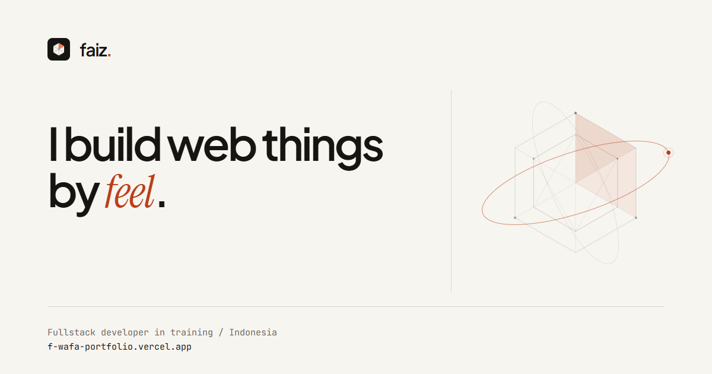

# Portfolio

Personal site of **Faiz Syaiful Wafa**, a fullstack developer in training in Indonesia. One page, a CV, and a public trail of the work.

- Live: [f-wafa-portfolio.vercel.app](https://f-wafa-portfolio.vercel.app)
- CV: [/cv](https://f-wafa-portfolio.vercel.app/cv)
- Source: [github.com/f-wafa/portfolio](https://github.com/f-wafa/portfolio)



## Stack

- Next.js 16 with the App Router and Turbopack
- React 19 and TypeScript
- Tailwind CSS 4
- React Three Fiber and three.js for the hero
- `next-themes` for light and dark mode
- GitHub REST API and the public contribution graph
- Vercel

## What is in the site

The home page is one column of sections: a hero, a short "now" strip, About, Work, Tools, GitHub, and Contact.

- **Work** lists repositories from the GitHub API. The two published projects have a screenshot and a short note; any future repository falls back to its GitHub name and description.
- **GitHub** shows project and contribution counts, three recent commits, and a 14-week activity graph. The data is cached on the server for an hour.
- **Contact** has the email address, a copy button, social links, and the CV download.
- **CV** is a printable page at `/cv`, with the PDF download in `public/cv/`.
- **Theme** follows the system by default and can be switched. Both modes share the same tokens and layout.
- **Hero** loads its WebGL scene after the text. The scene pauses when it is off-screen or the tab is hidden, and an SVG fallback covers browsers without WebGL or visitors who prefer reduced motion.

The site is statically rendered, with GitHub data cached hourly. There is no database and no client-side data fetching.

## Requirements

- Node.js 20.9 or newer
- npm

## Getting started

```bash
git clone https://github.com/f-wafa/portfolio.git
cd portfolio
npm install
```

Create `.env.local` from `.env.example` if you need either variable:

```dotenv
# Optional. Raises the GitHub API limit from 60 to 5,000 requests per hour.
GITHUB_TOKEN=

# Optional. Defaults to https://f-wafa-portfolio.vercel.app
NEXT_PUBLIC_SITE_URL=http://localhost:3000
```

Then start the dev server:

```bash
npm run dev
```

Open [http://localhost:3000](http://localhost:3000).

## Scripts

| Command | What it does |
| --- | --- |
| `npm run dev` | Starts the development server |
| `npm run build` | Creates the production build |
| `npm run start` | Serves the production build |
| `npm run lint` | Runs ESLint |

The build uses Cache Components and Partial Prefetching, both enabled in `next.config.ts`.

## Project structure

```text
src/
  app/
    (site)/            Home route with the shared header and footer
    cv/                The /cv page
    globals.css        Design tokens, base styles, motion, print styles
    layout.tsx         Fonts, metadata, theme provider
    robots.ts
    sitemap.ts
  components/
    hero/              WebGL scene, SVG fallback, theme and visibility guards
    projects/          Work section and project rows
    about-section.tsx
    github-section.tsx
    contact-section.tsx
    site-header.tsx
    site-nav.tsx
    site-footer.tsx
    reveal.tsx
    icons.tsx
  content/
    profile.ts         Name, email, socials, tool groups
    projects.ts        Screenshots, alt text, and notes for known repositories
    sections.ts        Navigation order and labels
    status.ts          Availability and the "now" line
  lib/
    github.ts          GitHub requests, hourly cache, and fallbacks
    format.ts          Date and number formatting
    site.ts            Site URL
public/
  shots/               Real screenshots used in Work
  cv/                  Downloadable CV PDF
  og.png               Social preview image
```

## GitHub data

All GitHub requests happen on the server in `src/lib/github.ts`. `fetchSnapshot` and `fetchActivity` use `use cache` with `cacheLife("hours")`, so the page does not call GitHub on every visit.

Two things can fail, and both have an honest fallback:

- If the user or repository request fails, the page uses a dated snapshot and a note says when it was captured.
- If the public contribution graph changes its markup, the parser returns `null` and the activity numbers are left out instead of estimated.

`GITHUB_TOKEN` is optional. Without it, requests are unauthenticated and limited to 60 per hour.

## Editing content

- `src/content/profile.ts` holds the name, email, social links, and the three tool groups.
- `src/content/status.ts` is the only file to change when availability changes.
- `src/content/sections.ts` sets the order and labels in the header, mobile menu, and footer.
- `src/content/projects.ts` adds a screenshot, alt text, stack tags, and a note for a known repository.
- `src/lib/github.ts` holds `REPO_COPY`, the verified descriptions for the published projects, plus the fallback snapshot.
- `src/app/cv/page.tsx` and `public/cv/faiz-syaiful-wafa-cv.pdf` hold the CV.

## Accessibility and motion

- A skip link, visible focus styles, and a keyboard-operable menu.
- The mobile menu is a native `<details>` element and closes with Escape.
- Tap targets are at least 44px.
- Every image has alt text, and the hero canvas is labelled as an image.
- The page has one `h1`, landmarks, and a page title.
- `prefers-reduced-motion` disables the reveal animation, the WebGL scene, and the navigation line.
- The nav marks the current section with `aria-current="location"` and a visible underline.

## Deployment

Import the repository into Vercel. Set `GITHUB_TOKEN` and `NEXT_PUBLIC_SITE_URL` in the project settings if you use them, then deploy. The default build command and output are the Next.js defaults.

For another Node host:

```bash
npm run build
npm run start
```

## License

MIT, see [LICENSE](LICENSE). The license covers the code. The CV, screenshots, and personal copy belong to Faiz; please do not republish them as your own.

Fonts are loaded with `next/font/google`: Plus Jakarta Sans, Instrument Serif, and JetBrains Mono. Icons are hand-written SVGs in `src/components/icons.tsx`, not an icon package.
